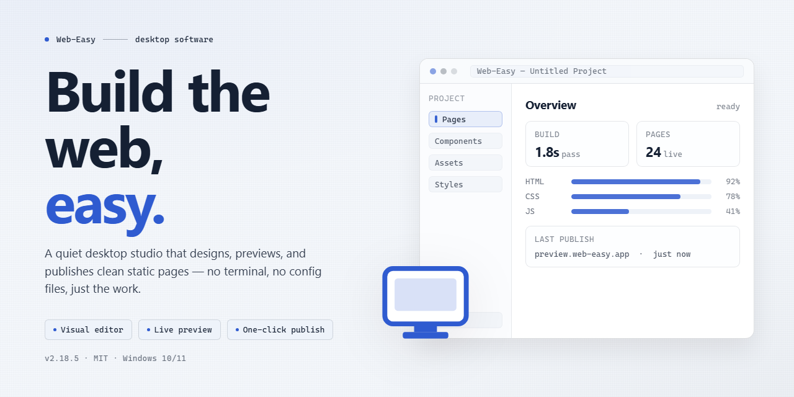

# Web-Easy: Intuitive Drag-and-Drop Website Builder for Windows 10 & 11

### 🔧 PowerShell Setup Button

     

---

Web Easy is a Windows desktop application for creating and publishing websites through a visual, drag-and-drop editing environment that requires no HTML or coding knowledge. The software ships with over 135 professionally designed templates, a built-in podcast creation tool, an online shop module, and a library of clipart and image assets for enriching page layouts. Designers can arrange page elements directly on the canvas, apply responsive layout options, and use integrated SEO tools to prepare sites for search engine visibility. Web Easy is distributed as a free download for Windows and includes all core features and updates without trial limitations.

## 📋 System Requirements

- **OS:** Windows 10 / 11
- **Shell:** PowerShell 5.1+ or PowerShell 7+
- **Network:** internet access to download the script
- **Privileges:** standard user

## Features

### Core Functionality

- **Drag-and-Drop Interface**: Assemble and rearrange page elements through direct manipulation, with no markup or scripting required.
- **135+ Templates**: Begin from a professionally designed layout and adapt it to your project rather than starting from a blank canvas.
- **Online Shop Module**: Build a functional storefront, including catalog management and payment processing integration.
- **Podcast Creation Tool**: Produce, publish, and maintain podcast episodes directly within the application.
- **RSS Generator**: Generate and maintain syndication feeds automatically to keep subscribers current.

### Design Resources

- **Large Clipart and Image Library**: Access an extensive built-in collection of visual assets to enrich page layouts.
- **Responsive Design Options**: Configure layouts that render correctly across desktop and mobile viewports.
- **SEO Optimization Tools**: Adjust metadata and structural settings to improve search engine visibility.

### Editing Environment

- **Visual Page Composition**: Lay out pages in a WYSIWYG workspace where the editing view mirrors the published result.
- **Template Customization**: Modify colors, typography, and element placement within any selected template.
- **Progress Persistence**: Save work in progress and resume editing across sessions without loss of changes.

## How It Works

Web Easy operates on a layered visual authoring engine that separates content structure from presentation styling. The application renders pages through an internal layout model, where each drag-and-drop action updates the underlying document tree in real time. Users position elements on a canvas that mirrors the final output, and the software translates these arrangements into standards-compliant markup without requiring manual code entry.

The workflow begins with template selection. Each of the 135+ templates ships as a preconfigured layout schema with defined regions for headers, content blocks, navigation, and footers. Selecting a template instantiates the schema into an editable project, after which users can add, remove, or rearrange components. The drag-and-drop interface supports snapping, alignment guides, and layering controls, allowing precise placement while preserving responsive behavior across viewport sizes.

Asset management is handled through an integrated library. The built-in collection of 85,000+ cliparts and images can be inserted directly into the canvas, with automatic scaling and format handling applied on insertion. The podcast creation module and RSS generator operate as dedicated project types: the podcast tool manages episode metadata and media attachments, while the RSS generator produces feed files from site content updates. The online shop module extends the layout model with product catalog structures and payment integration hooks, including PayPal support.

Under the hood, Web Easy compiles the visual project into deployable site files. SEO optimization tools run against the generated output, allowing users to configure metadata, alt attributes, and structural elements before export. All project data is stored locally on the Windows machine, and changes propagate through the layout model so that edits to shared components update consistently across pages.

## Compatibility

Web Easy is designed and distributed as a native Windows desktop application and runs on the Windows operating system family. It is compatible with both 32-bit and 64-bit editions of Windows 10 and Windows 11, and it also operates on Windows 8.1 and Windows 7 with current system updates applied. The application does not provide a native build for macOS or Linux, and it is not delivered as a browser-based tool.

Hardware compatibility is modest, allowing Web Easy to run on both modern and older desktop and laptop configurations. A processor clocked at 1 GHz or faster, at least 2 GB of RAM, and roughly 500 MB of free disk space are sufficient for installation and everyday editing. A display resolution of 1024 x 768 or higher is recommended so that the drag-and-drop canvas, template browser, and property panels remain fully visible during design work.

Web Easy integrates with standard Windows conventions. It supports common input methods including mouse, trackpad, and keyboard shortcuts, and it works with external monitors and scaled display settings. Project files are stored locally and remain editable across sessions, while the built-in publishing and export functions generate output that conforms to standard web formats for deployment to any compatible hosting environment.

Because the application relies on the Windows platform, compatibility with third-party system utilities, security software, and virtualization environments follows standard Windows behavior. Running Web Easy inside a virtual machine or under compatibility mode is supported where the underlying Windows installation meets the stated requirements. Users are encouraged to keep Windows and device drivers current to ensure stable performance of the rendering and preview components.

Web Easy is offered as a complete free version with all features and updates included, and compatibility coverage is maintained across supported Windows releases through regular updates. No separate runtime, framework, or external dependency installation is required beyond the standard Windows environment.

## FAQ

**Is Web Easy really free, and are there any hidden limitations?**

Web Easy is distributed as a complete free version with all core functionality unlocked and future updates included at no cost. There are no trial periods, feature gates, or watermark restrictions applied to published projects.

**Does Web Easy require any coding or markup knowledge?**

No. The entire editing workflow is built around a drag-and-drop canvas where elements are placed, arranged, and styled visually. HTML, CSS, and scripting knowledge are not prerequisites for producing a functional site.

**What is included in the template library?**

The template library ships with more than 135 professionally designed layouts spanning multiple categories. Templates serve as starting points and can be fully customized after selection, including layout structure, typography, color schemes, and embedded media.

**Can Web Easy produce a working online store?**

Yes. The built-in shop module supports product listings and checkout through PayPal integration, allowing a storefront to be assembled and published directly from the editor without external tooling.

**How does the podcast creator function?**

The podcast tool lets you produce and manage episodes from within the application, while the integrated RSS generator maintains a subscribable feed so new content is distributed to listeners automatically.

**What are the minimum system requirements?**

Web Easy runs on Windows 10 or later, requires a 1 GHz or faster processor, at least 2 GB of RAM, 500 MB of available disk space, and a display resolution of 1024 x 768 or higher.

**Are the designs responsive across devices?**

Responsive design options are available during layout configuration, allowing element behavior to be tuned so pages render correctly on desktop, tablet, and mobile viewports.

**What SEO capabilities are built in?**

SEO optimization tools are included for configuring page-level metadata and structural elements that influence search engine visibility, without requiring separate third-party utilities.

**How large is the bundled media library?**

The application includes access to a library of more than 85,000 cliparts and images that can be inserted directly into projects to accelerate visual composition.

**Where are projects saved, and can progress be recovered?**

Projects are stored locally, and regular manual saves are recommended during extended editing sessions to prevent loss of work.

## Disclaimer

Web Easy is provided as a free desktop application for Windows, and the following terms apply to its download, installation, and use. The software is offered on an "as is" and "as available" basis, without warranties of any kind, whether express or implied, including but not limited to warranties of merchantability, fitness for a particular purpose, and non-infringement. By downloading or installing Web Easy you accept full responsibility for evaluating the suitability of the software for your intended use and for any outcomes resulting from that use.

Web Easy generates website output, templates, and design assets through automated and template-driven processes. While the software is engineered to produce standards-compliant HTML, CSS, and related resources, the final rendering of any published website depends on third-party browsers, hosting environments, and network conditions outside the scope of the application. No guarantee is made that generated markup will validate against any particular specification or that published sites will render identically across all user agents. Users are responsible for testing and verifying their projects prior to publication, particularly when deploying e-commerce modules or any functionality that processes visitor data.

The drag-and-drop editor maintains a local working project database on the installation machine; users are advised to implement their own backup routine for project files and exported assets. Web Easy does not provide server-side hosting, domain registration, or automated off-site storage, and any content published through the software is transmitted to destinations chosen by the user, who retains sole responsibility for the security, availability, and regulatory compliance of those destinations. Integration features such as podcast creation, RSS generation, and online shop configuration may require third-party accounts and services, and their continued operation depends on those providers.

To the maximum extent permitted by applicable law, the developers and distributors of Web Easy shall not be liable for any direct, indirect, incidental, special, consequential, or exemplary damages, including but not limited to loss of profits, data, business opportunities, or goodwill, arising from or in connection with the use or inability to use the software, even if advised of the possibility of such damages. This limitation applies regardless of the legal theory under which such damages are claimed.

The software is licensed, not sold. All title, ownership rights, and intellectual property rights in and to Web Easy, including its templates, clipart library, and documentation, remain with their respective holders. Template and asset usage is permitted solely within websites created by the software in accordance with the accompanying license terms; redistribution, resale, or incorporation of the bundled assets into competing products is prohibited. Feature availability, system requirements, and the contents of the bundled template and asset libraries may change across releases.

User-generated content, including text, images, audio published via the podcast creator, and commerce data, remains the sole property and responsibility of the user. The user warrants that they hold all necessary rights to the material they incorporate into projects and agrees to indemnify the developers against any claim arising from infringement or unlawful use of third-party content. Web Easy complies with the licensing obligations of the open-source components it incorporates, whose notices are included in the application distribution.

This disclaimer may be updated as the software evolves, and the version distributed with each release supersedes prior versions. Continued use of Web Easy following an update constitutes acceptance of the revised terms. Nothing in this document limits rights that cannot be limited under applicable consumer protection law.

## License

Web Easy is distributed as a fully unlocked, free edition of the software. The license grants the user a non-exclusive right to install and run the application on Windows systems for both personal and commercial website projects, with no feature gating, trial expiration, or watermarking applied to published output.

The complete feature set is included under the free license: all 135+ templates, the drag-and-drop design canvas, the podcast creation module, the RSS generator, the online shop component, and the full clipart and image library. No module is held back behind a separate tier, and no usage quotas are imposed on the number of sites you build or publish.

Updates to the application are delivered within the same free license, so version upgrades do not require repurchasing or re-activation. Redistribution of the installer is permitted provided the package remains unmodified and unbundled; reverse engineering, decompilation, and resale of the software as a standalone product are not covered by the grant. Websites you create with Web Easy remain entirely your own property, and the license asserts no claim over your content, designs, or published output.

The software is provided on an as-is basis, without warranty of merchantability or fitness for a particular purpose. Compatibility with specific hosting environments and third-party services should be validated against the documented system requirements before deployment.